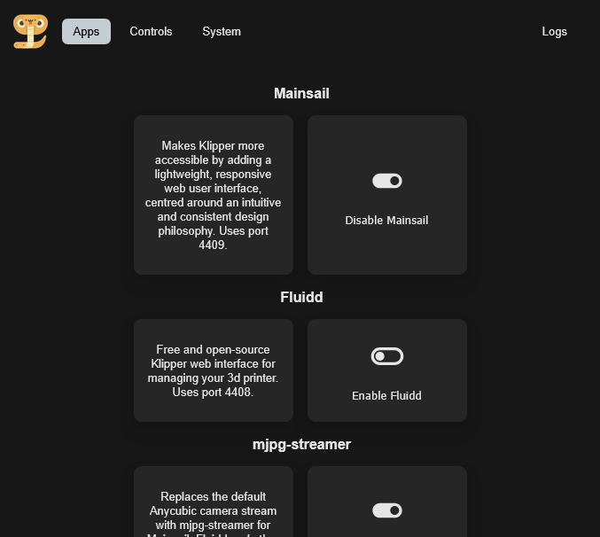

# Rinkhals Web UI app

A web interface for [Rinkhals](https://github.com/jbatonnet/Rinkhals) and Kobra-specific features.

## Features

- Toggle Rinkhals apps
- Toggle ACE auto-refill function
- Control ACE filament drying function
- Change ACE filament information
- Check for firmware updates in LAN or Cloud mode[^1]
- And more!

[^1]: Update checking connects to Anycubic Cloud with the printer ID.



## Installation

- Download the `update.swu` file for the app from the releases page.
- Copy it to a FAT32 formatted USB drive in a directory named: **aGVscF9zb3Nf**
- Plug the USB drive in the Kobra and the app will be installed.
- You will hear two beeps, the second one will tell you that the app is installed. There is no need to reboot afterwards.

You might need to enable the app via the Rinkhals touch UI for it to start.

The web UI can be accessed at: `http://<printer-ip>:1414`

## Development

This project uses a [dev container](https://containers.dev/) with build dependencies pre-configured.

To get started, open this repository in VS Code and select **Reopen in Container** when prompted (or run the **Dev Containers: Reopen in Container** command). This requires [Docker](https://www.docker.com/) and the [Dev Containers extension](https://marketplace.visualstudio.com/items?itemName=ms-vscode-remote.remote-containers).

### Build

To build the full `update.swu` packages:

```
hatch run build
```

This runs three steps in sequence:
1. `build-frontend`: builds the web frontend
2. `build-mpy`: compiles Micropython bytecode
3. `build-swu`: creates installation packages

Individual steps can also be run separately: `hatch run <step-name>`.

Output files are written to `build/dist/`.
